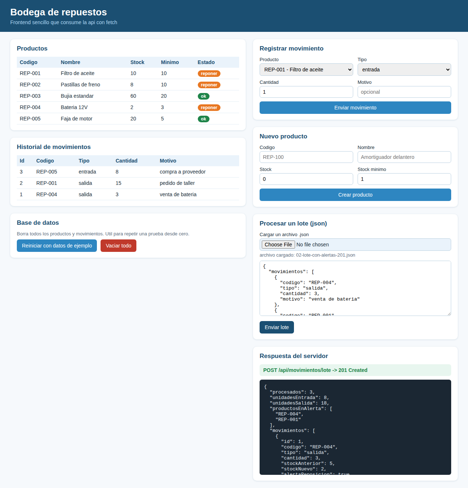

# Bodega de repuestos: API en C# con SQLite, frontend y Postman

Ejemplo del laboratorio de IPC2 (Unidad 8). Una API hecha con ASP.NET Core Minimal API que **recibe JSON, lo procesa y lo guarda en SQLite**, con un frontend en HTML y JavaScript puro, una colección de Postman lista para importar y archivos JSON de prueba.

El tema es una bodega de repuestos. Los productos tienen un stock y un stock mínimo. Cada **movimiento** (entrada o salida) llega como JSON, se valida, se aplica con una regla de negocio y queda en un historial. También se pueden enviar **varios movimientos en un solo JSON (lote)**: se aplican todos o no se aplica ninguno.



## Estructura

```
BodegaApi/
├── BodegaApi.csproj             proyecto web (net10.0) y el paquete Microsoft.Data.Sqlite
├── Program.cs                   arranque: servicios, archivos estáticos y rutas
├── Properties/launchSettings.json   puerto fijo 5080
├── Modelos/                     una clase por archivo: lo que entra y sale como JSON
├── Datos/BodegaRepositorio.cs   todo el SQL vive aquí (consultas con parámetros)
├── Servicios/ProcesadorMovimientos.cs   validación, regla de stock y transacciones
├── Endpoints/                   rutas http: productos, movimientos y administración
├── wwwroot/                     frontend: index.html, estilos.css, app.js
├── datos-prueba/                23 archivos JSON: lotes/, movimientos/ y productos/
└── postman/Bodega.postman_collection.json   24 requests con tests
```

## Cómo ejecutarlo

Requisito: .NET SDK 10.

```bash
cd BodegaApi
dotnet run
```

- Abre `http://localhost:5080` para ver el frontend.
- La base de datos `bodega.db` se crea sola junto al proyecto, con cinco repuestos de ejemplo.
- Para volver al estado inicial usa el botón **Reiniciar con datos de ejemplo** del frontend (o `POST /api/reiniciar`).
- En Rider o Visual Studio: abre el `.csproj` y ejecuta el perfil `http`.

## Cómo probarlo con Postman

1. En Postman: **Import** y elige `postman/Bodega.postman_collection.json`.
2. La variable `baseUrl` ya apunta a `http://localhost:5080`. Cámbiala si usas otro puerto.
3. Con la API corriendo, abre la colección y usa **Run collection**. Cada request trae tests que verifican el código de estado y el cuerpo.
4. La colección empieza reiniciando los datos y termina restaurándolos, así que se puede ejecutar varias veces seguidas.

Para crear un request a mano: método `POST`, URL `http://localhost:5080/api/movimientos`, pestaña **Body** → **raw** → **JSON**:

```json
{ "codigo": "REP-001", "tipo": "entrada", "cantidad": 10, "motivo": "compra a proveedor" }
```

Postman agrega solo la cabecera `Content-Type: application/json`. Sin ella, la API responde 415.

Para enviar uno de los archivos de `datos-prueba/`: en la pestaña **Body** elige **binary**, selecciona el archivo y agrega a mano la cabecera `Content-Type: application/json` (en modo binary Postman no la pone). También sirve abrir el archivo y pegarlo en el modo **raw** → **JSON**.

## Endpoints

| Método | Ruta | Qué hace | Respuestas |
|---|---|---|---|
| GET | `/api/productos` | Lista los productos | 200 |
| GET | `/api/productos/{codigo}` | Un producto | 200, 404 |
| POST | `/api/productos` | Crea un producto (JSON) | 201, 400, 409 |
| POST | `/api/movimientos` | Aplica una entrada o salida (JSON) | 201, 400, 404, 409 |
| POST | `/api/movimientos/lote` | Aplica una lista de movimientos (JSON) | 201, 400, 404, 409 |
| GET | `/api/movimientos?codigo=&limite=` | Historial, más reciente primero | 200 |
| POST | `/api/reiniciar?ejemplo=true` | Borra todos los datos y carga los de ejemplo | 200 |
| POST | `/api/reiniciar?ejemplo=false` | Borra todos los datos y deja la base vacía | 200 |

Todos los errores de negocio responden con el mismo formato: `{ "error": "mensaje" }`.

### Reglas del procesamiento

- El código se normaliza a mayúsculas y el tipo a minúsculas: `rep-001` y `REP-001` son el mismo producto.
- El tipo solo puede ser `entrada` o `salida`. La cantidad es un entero entre 1 y 100000.
- Una salida mayor al stock disponible responde **409** y no cambia nada.
- Si el stock queda igual o por debajo del mínimo, la respuesta trae `"alertaReposicion": true`.
- En un lote, el primer movimiento que falla deshace los anteriores (transacción de SQLite) y el mensaje indica cuál fue: `movimiento 2: ...`.
- Un JSON mal formado responde 400 antes de llegar al código propio. En modo Development el cuerpo trae el detalle técnico de la excepción; en producción llega vacío.

## Frontend

- **Cargar un archivo .json:** el selector lee el archivo elegido y lo muestra en el cuadro de texto. Así se revisa (o se edita a propósito) antes de pulsar **Enviar lote**. El navegador no permite leer rutas del disco, por eso hace falta el selector.
- **Base de datos:** **Reiniciar con datos de ejemplo** y **Vaciar todo** piden confirmación antes de borrar. Ambos usan la misma ruta, `POST /api/reiniciar`.
- **Respuesta del servidor:** muestra el método, la ruta, el código de estado y el cuerpo de la última petición.

> `/api/reiniciar` borra todo sin pedir credenciales. Está bien para un laboratorio local; en una aplicación real exigiría autenticación (tema 8.12).

## Archivos JSON de prueba

El código de estado esperado va al final del nombre de cada archivo. Están pensados para el estado inicial, así que conviene pulsar **Reiniciar con datos de ejemplo** antes de cada prueba.

**`datos-prueba/lotes/`** (se envían a `/api/movimientos/lote`, o se cargan con el selector del frontend)

| Archivo | Qué prueba | Resultado |
|---|---|---|
| `01-lote-valido` | Tres movimientos correctos | 201, entradas 21, salidas 5, sin alertas |
| `02-lote-con-alertas` | Dos productos quedan en el mínimo o debajo | 201, alertas `REP-004` y `REP-001` |
| `03-lote-alerta-se-resuelve` | Un producto baja del mínimo y se repone en el mismo lote | 201, sin alertas: se usa el stock final |
| `04-lote-mayusculas-y-minusculas` | Código y tipo en otro formato (`rep-005`, `ENTRADA`) | 201: se normalizan |
| `05-lote-stock-insuficiente` | El segundo movimiento pide más de lo que hay | 409 y el primero se deshace |
| `06-lote-producto-inexistente` | El segundo movimiento usa un código que no existe | 404 |
| `07-lote-tipo-invalido` | Tipo `traslado` | 400 |
| `08-lote-cantidad-cero` | Cantidad 0 | 400 |
| `09-lote-vacio` | Lista vacía | 400 |
| `10-lote-elemento-nulo` | La lista trae `null` | 400 |
| `11-lote-sin-propiedad-movimientos` | La propiedad se llama `movs` en vez de `movimientos` | 400 |
| `12-lote-json-roto` | JSON incompleto a propósito | 400 |

**`datos-prueba/movimientos/`** (a `/api/movimientos`): entrada 201, salida 201, salida con alerta 201, stock insuficiente 409, producto inexistente 404 y tipo inválido 400.

**`datos-prueba/productos/`** (a `/api/productos`): producto nuevo 201, código duplicado 409, stock negativo 400, sin nombre 400 y stock escrito como texto 400.

## Conceptos que cubre

| Concepto | Dónde verlo |
|---|---|
| Métodos HTTP (GET, POST) y recursos | `Endpoints/` |
| Códigos de estado 200, 201, 400, 404, 409, 415 | tests de Postman y panel "Respuesta del servidor" del frontend |
| Cabeceras `Content-Type` y `Location` | request 415 y request "Crear producto" |
| JSON de entrada y salida | `Modelos/` y el cuadro de lote del frontend |
| Validación y regla de negocio | `Servicios/ProcesadorMovimientos.cs` |
| SQLite con consultas parametrizadas | `Datos/BodegaRepositorio.cs` |
| Transacciones (todo o nada) | `ProcesarLote`, `Reiniciar` y el request "Lote con un error" |
| Subir y leer un archivo en el navegador | selector de archivo en `wwwroot/app.js` |
| Inyección de dependencias | `Program.cs` |
| `fetch`, `async` y `await` en el navegador | `wwwroot/app.js` |

## Ideas para extender

- Agregar `PUT` y `DELETE` para productos y revisar qué códigos corresponden.
- Exigir un token en la cabecera `Authorization` y responder 401 o 403 (tema 8.12).
- Agregar una consulta de productos con alerta de reposición.

## Nota de transparencia

- El entorno donde se generó este ejemplo no tenía .NET 10 ni acceso a NuGet. El código se compiló con el SDK de .NET 8 en una copia de verificación (0 errores y 0 advertencias) y se ejecutó contra un reemplazo mínimo de `Microsoft.Data.Sqlite` construido sobre la librería SQLite real, con las mismas llamadas que usa `BodegaRepositorio`.
- Con esa ejecución se probaron todos los endpoints y sus códigos, los 23 archivos de `datos-prueba/` (cada uno devolvió el código de su nombre) y la colección de Postman, corrida dos veces seguidas con `newman` (42 aserciones, 0 fallos). El frontend, incluido el selector de archivo y los botones de reinicio, se probó en Chromium.
- No se probó el paquete NuGet `Microsoft.Data.Sqlite` real ni el destino `net10.0`. Si tu SDK o el paquete dan algún aviso de versión, ajusta `Version` en el `.csproj`.
- Este ejemplo no trata estructuras de datos propias: usa `List<T>` para convertir listas a JSON y para el lote. Si el proyecto exige evitar colecciones nativas, hay que adaptar esas partes.
